  

  
  
  

## Sobre mim

Estudante do Ensino Médio Integrado ao Técnico em Informática no **IFPB — Campus Itaporanga**, com foco em desenvolvimento web e engenharia de software. Também me interesso por arquitetura, segurança e aplicações desktop.

Aprendo construindo: cada projeto parte de um problema concreto, tem código aberto e registra o que ainda falta.

**Busco meu primeiro estágio ou vaga de desenvolvedor trainee.**

## Projetos em destaque

### [LexContract](https://github.com/muryllodouglashsoares/law-contract-management) — gestão de contratos para escritórios de advocacia

Substitui planilhas e e-mail por um fluxo rastreável de clientes, contratos e pagamentos.

- Multi-tenant por escritório, com papéis (`ADMIN`, `LAWYER`, `ASSISTANT`) verificados no backend e 2FA (TOTP) opcional.
- Contratos gerados a partir de modelos, aceite eletrônico por link de uso único, parcelas e histórico de auditoria.
- CI com testes de integração e E2E; o deploy só roda depois que todas as etapas passam.

`React` `TypeScript` `Fastify` `PostgreSQL` `Prisma` `Playwright` `Docker` 
**Estado:** funcional, com demo publicada. O aceite é assinatura eletrônica simples (não ICP-Brasil). 
[Código](https://github.com/muryllodouglashsoares/law-contract-management) · [Demo](https://law-contract-management.pages.dev) · [Estudo de caso](https://portfolio-c1u.pages.dev/projects/lexcontract)

  
  

### [Tekidu](https://github.com/muryllodouglashsoares/Tekidu) — gestão acadêmica

Notas, frequência, boletim e comunicados em um só lugar, com quatro perfis: administrador, professor, estudante e responsável (somente leitura).

- A autorização está nas Firestore Security Rules, com testes de acesso permitido e negado no Firebase Emulator.
- Exportação de boletim em PDF e de relatórios em Excel/PDF.
- PWA instalável, painel de acessibilidade e páginas carregadas sob demanda por perfil.

`React` `TypeScript` `Firebase` `Cloudflare` `Vitest` 
**Estado:** em desenvolvimento. Faltam CI/CD, testes de componentes e auditoria de acessibilidade. 
[Código](https://github.com/muryllodouglashsoares/Tekidu) · [Aplicação](https://tekidu.pages.dev/) · [Estudo de caso](https://portfolio-c1u.pages.dev/projects/tekidu)

  
  

### [Evidence Finder](https://github.com/muryllodouglashsoares/evidence-finder) — pesquisa local em evidências digitais

App desktop para reencontrar informações em prints, PDFs e textos e saber de onde vieram.

- Núcleo em Rust com um banco SQLite por projeto; pesquisa exata (FTS5), por significado (embeddings locais) e híbrida.
- OCR local com Tesseract e exportação em PDF com `manifest.json` e verificação de SHA-256 das fontes.
- Sem cliente de rede nem telemetria, verificado por testes.

`Tauri` `Rust` `React` `TypeScript` `SQLite` 
**Estado:** v0.1.0 em desenvolvimento. Faltam validação em Windows, instalador e testes com o modelo semântico real. 
[Código](https://github.com/muryllodouglashsoares/evidence-finder) · [Estudo de caso](https://portfolio-c1u.pages.dev/projects/evidence-finder)

  
  

### [GitFlow Desktop](https://github.com/muryllodouglashsoares/gitflow) — interface gráfica para Git

Mostra o que cada operação vai fazer antes de executá-la.

- Commit só com os arquivos selecionados (nunca `git add .`), com revisão do diff e recusa se algo mudou depois da revisão.
- Git executado sem shell, caminhos validados e nenhuma operação com `--force`.
- Branches, fetch/pull/push, importação de ZIP revisável e merge com prévia de conflitos.

`Tauri` `Rust` `React` `TypeScript` 
**Estado:** em desenvolvimento (fases 1 a 5). Sem resolução visual de conflitos nem pull requests. 
[Código](https://github.com/muryllodouglashsoares/gitflow)

## Mais projetos

- **[IFConnect](https://github.com/muryllodouglashsoares/IFConnect)** — rede social acadêmica com chat em tempo real, feita só com Firebase, sem backend próprio · [Estudo de caso](https://portfolio-c1u.pages.dev/projects/ifconnect)
- **Landing pages de portfólio** (negócios fictícios, React + Tailwind) — [Savora](https://github.com/muryllodouglashsoares/savora-landing-page) · [FORJA](https://github.com/muryllodouglashsoares/gym-landing-page) · [OdontoPrime](https://github.com/muryllodouglashsoares/clinica-landing-page)
- **[Mini Olimpíada de Robótica](https://github.com/muryllodouglashsoares/mini-robotics-competition)** — robô seguidor de linha em LEGO Spike Prime, em blocos e em Python
- **[Woman Importance](https://github.com/muryllodouglashsoares/gamer-make-project)** — jogo 2D em GameMaker sobre respeito e igualdade de gênero

## Stack

Tecnologias que usei nos projetos acima, agrupadas por onde apareceram.

| Área | Tecnologias | Onde usei |
| --- | --- | --- |
| Frontend |     | Todos os projetos web |
| Backend e dados |      | LexContract (API), Tekidu e IFConnect (Firebase) |
| Desktop |    | Evidence Finder e GitFlow Desktop |
| Qualidade e infra |      | Testes, CI e deploy (LexContract, Tekidu) |

## Formação e conquistas

- **Formação:** Ensino Médio Integrado ao Técnico em Informática, IFPB — Campus Itaporanga.
- **Estudando agora:** estruturas de dados e algoritmos · arquitetura de software · robótica autônoma.
- **Conquista:** Honra ao Mérito na OPI (Olimpíada Paraibana de Informática).

## Contato

[Portfólio](https://portfolio-c1u.pages.dev/) · [LinkedIn](https://www.linkedin.com/in/muryllo-douglas-henrique-soares-7a8416416/) · [E-mail](mailto:muryllodouglash.soares@gmail.com)

  

